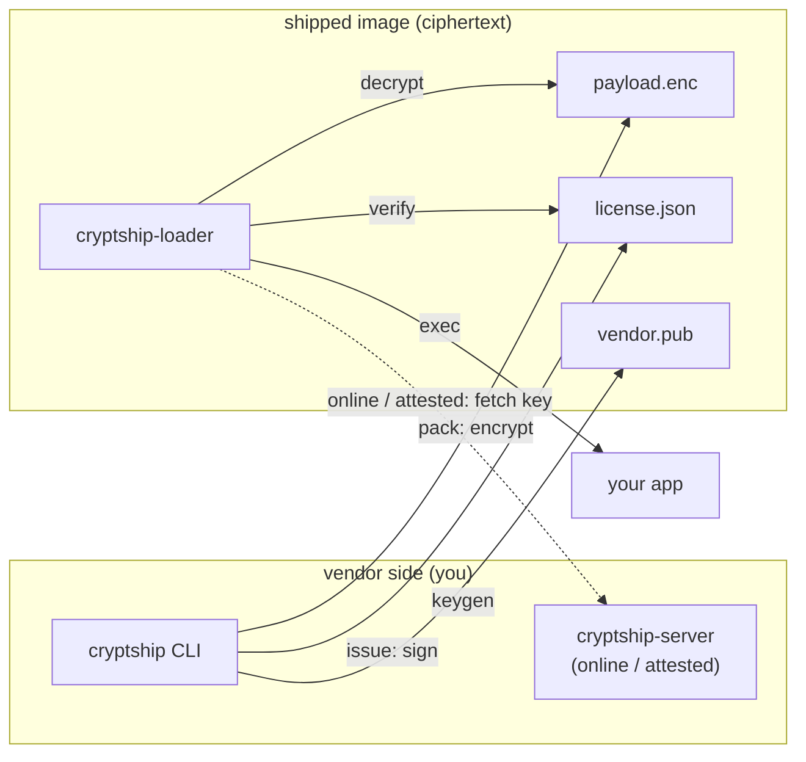
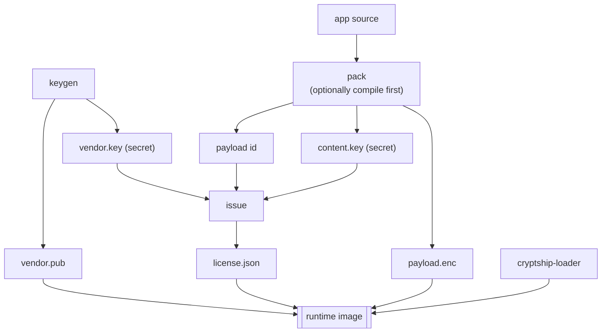
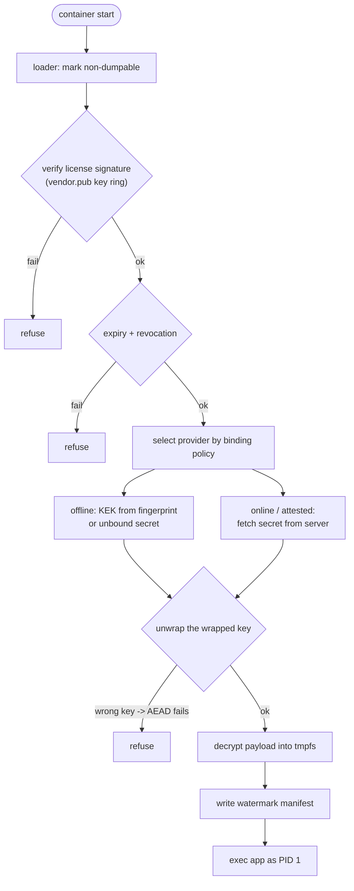
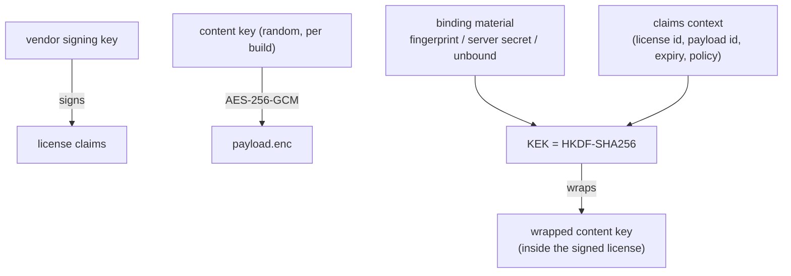

# What cryptship solves, and how it works

## The problem

When you ship software as a Docker image, **the source ships in the clear**.
Anyone who has the image can `docker save`, unpack the layers, and read
everything — and for interpreted languages (Python, Node, Ruby) that is your
actual, readable source. For a closed-source product that is your IP leaking by
default. And with AI, lifting that source and reworking it into a competing
product — change a few things, rebrand — is cheap and fast.

cryptship makes the shipped image **ciphertext**: the app is encrypted, and a
small loader decrypts and runs it only when a valid license is present.

| It stops… | How |
|---|---|
| `docker save` + read the source | the image contains only `payload.enc` (AES-256-GCM) |
| sharing a license across machines | binding wraps the key to a fingerprint / server |
| running after a license is pulled | `online` mode — the server declines, instantly |
| a dump yielding clean source | compile before sealing → bytecode / native, not `.py` |
| a non-root in-container attacker | hardening: non-dumpable, seccomp, non-root, tmpfs |
| an untraceable leak | per-license watermark names the licensee |

**What it does _not_ solve (stated honestly):** code that runs on hardware the
customer controls can always be extracted by **host root** dumping memory. No
software trick changes that — only **confidential computing** (SEV-SNP/TDX, the
`attested` mode, with a guest you control) or **remote execution** (the code
never ships) truly prevents it. cryptship's goal is to make casual copying
impossible and serious extraction cost more than a license — and, with
compilation, to yield compiled artifacts rather than source even when it fails.

The core guarantee: **validity == decryptability.** The content key is *derived*
from the license and binding material, so there is no "is it valid?" boolean to
patch — tampering produces a wrong key, and the AEAD simply fails.

---

## Architecture



Internally: `pkg/crypto` (AEAD + KEK), `pkg/license` (signed claims + key ring),
`pkg/machine` (fingerprint), `pkg/archive` (safe tar), `pkg/keyprovider`
(offline / online / attested), `pkg/online` + `pkg/licenseserver` (the server).

---

## Build-time flow (vendor)



---

## Run-time flow (loader, every container start)



---

## Online / attested sequence

```mermaid
sequenceDiagram
  participant L as loader (in container)
  participant S as cryptship-server (key broker)
  L->>L: verify license + expiry
  L->>S: POST /v1/key — license_id, nonce [, attestation]
  S->>S: denylist check (revocation)
  S->>S: attestation check (attested mode only)
  S->>S: secret = HKDF(master, license_id)
  S-->>L: signed response — secret, not_after; echoes nonce
  L->>L: verify signature + nonce
  L->>L: derive KEK, unwrap content key
  L->>L: decrypt to tmpfs, exec app
```

Revocation is immediate: the server returns `410 Gone` and the app refuses to
start. The signed, nonce-bound response means a proxy cannot forge or replay a
"yes".

---

## Key hierarchy



The content key encrypts the payload **once per build**; each license wraps that
same key under a KEK that only reconstitutes with the right binding material. The
claims context in the KEK means editing any policy claim breaks the unwrap — so
`validity == decryptability` holds even against a patched loader.
